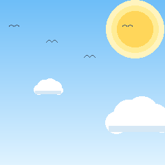
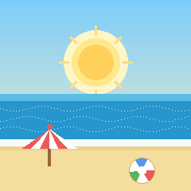

# Pomodoro Desktop App

[](https://github.com/tahergaming13/pomodoro-gifs/actions/workflows/build-release.yml)
[](https://github.com/tahergaming13/pomodoro-gifs/releases/latest)
[](https://github.com/tahergaming13/pomodoro-gifs/releases)
[](LICENSE)


Floating, borderless, always-on-top Pomodoro timer for Windows 64-bit.
C++17 · Dear ImGui + SDL2 + OpenGL · animated GIF per phase · global hotkey.

<p align="center">
  
  
  
</p>

## Features

- **Mini floating widget** (190×232, default): just the rocket mascot with a transparent background + the time below it, parked in the screen corner. Time tinted by phase (red = work, green = short break, blue = long break) and dimmed while paused
- **Click the widget to open the full app**: timer controls, session dots, progress bar, settings panel. Collapse back anytime with the `-` button or right-click menu
- **Floating + transparent**: borderless, always-on-top panel, drag to move
- **Full Pomodoro cycle**: WORK → SHORT BREAK → LONG BREAK with session dots
- **Animated GIF per state**: rocket (work), clouds (short break), beach (long break)
- **Sound**: `Beep()` jingle on every phase change (runs on detached thread, UI never freezes)
- **Global hotkey** `Ctrl+Alt+P` → start/pause, works even when unfocused
- **Settings panel**: all durations + cycles, sound, always-on-top, persisted to `settings.ini` next to the `.exe` (window position too)
- **Drag to move** anywhere on the background · **right-click menu** (Start/Pause, Skip, Reset, Settings, Quit) · **X** button to quit
- **Single `.exe`, no console**: `SDL2.dll` + `assets/` bundled next to it

---

## Quick Start — Pre-built Release (Recommended)

**Download directly:** [Pomodoro-v1.0.0-win64.zip](https://github.com/tahergaming13/pomodoro-gifs/releases/latest/download/Pomodoro-v1.0.0-win64.zip)

1. Download the zip from the [latest release](https://github.com/tahergaming13/pomodoro-gifs/releases/latest)
2. Extract to any folder (e.g., `C:\Tools\Pomodoro\`)
3. Run `Pomodoro.exe` — that's it!

> The zip contains `Pomodoro.exe`, `SDL2.dll`, and the `assets/` folder.
> **No installer, no dependencies, no Visual C++ redistributable** — the MinGW
> runtime is statically linked, so it runs on a clean Windows 10/11 x64 machine.

### Optional: Desktop shortcut

Right-click `Pomodoro.exe` → **Send to** → **Desktop (create shortcut)**, then
pin it to the taskbar if you like. If you ran the build script, a shortcut is
already placed on your Desktop.

---

## One-Command Install (recommended if you don't want to touch zip files)

Open PowerShell and run:

```powershell
irm https://raw.githubusercontent.com/tahergaming13/pomodoro-gifs/main/scripts/install.ps1 | iex
```

This will:
1. Download the latest release zip
2. Extract it to `%LOCALAPPDATA%\Programs\Pomodoro` (no admin needed)
3. Create a **Desktop** shortcut and a **Start Menu** entry
4. Offer to launch it

Uninstall with:

```powershell
.\scripts\install.ps1 -Uninstall
```

Custom location / version:

```powershell
.\scripts\install.ps1 -Version v1.0.0 -InstallDir "D:\Apps\Pomodoro"
```

---

## Install Dependencies Automatically (Build from Source)

If you want to build yourself, run the **one-command installer** that sets up everything:

```powershell
# Run in PowerShell as Administrator (required for winget)
irm https://raw.githubusercontent.com/tahergaming13/pomodoro-gifs/main/scripts/install-deps.ps1 | iex
```

**What it installs:**
- **CMake** (via winget)
- **WinLibs GCC 16.2** (MinGW-w64, UCRT, POSIX threads) — space-free path at `C:\pbuild\mingw64`
- **Python 3** (for GIF regeneration script)
- **Git** (if not present)

> **Note:** WinLibs GCC fails when installed under a path containing spaces (e.g., `C:\Users\My Name\...`). The installer works around this by copying the toolchain to `C:\pbuild\mingw64`.

---

## Build from Source

### Prerequisites (after running installer above, or manually)

| Tool | Version | Install Command |
|------|---------|-----------------|
| CMake | ≥ 3.16 | `winget install Kitware.CMake` |
| MinGW (WinLibs) | GCC 16.2 | `winget install BrechtSanders.WinLibs.POSIX.UCRT` |
| Python | 3.10+ | `winget install Python.Python.3.12` |
| Git | latest | `winget install Git.Git` |

### Configure & Build (MinGW)

```powershell
# Open a NEW PowerShell window after installing tools (PATH refresh)
cd PomodoroApp

# NOTE: forward slashes — CMake writes the RC compiler path unescaped, so
# Windows backslashes break windres.
$gcc = "C:/pbuild/mingw64/bin"
& "$env:ProgramFiles\CMake\bin\cmake.exe" -S . -B build -G Ninja `
  -DCMAKE_C_COMPILER="$gcc/gcc.exe" `
  -DCMAKE_CXX_COMPILER="$gcc/g++.exe" `
  -DCMAKE_MAKE_PROGRAM="$gcc/ninja.exe" `
  -DCMAKE_RC_COMPILER="$gcc/windres.exe" `
  -DCMAKE_BUILD_TYPE=Release

& "$env:ProgramFiles\CMake\bin\cmake.exe" --build build

# Run
.\build\bin\Pomodoro.exe
```

### Build with MSVC (Visual Studio 2022)

```powershell
# Requires: Visual Studio 2022 with "Desktop development with C++" workload
cmake -S . -B build
cmake --build build --config Release
.\build\bin\Release\Pomodoro.exe
```

> The `vendor/` folder already contains all third-party sources (SDL2, Dear ImGui, stb_image). No submodules, no external downloads during build.

---

## Project Layout

```
PomodoroApp/
├── assets/              # GIF assets (rocket.gif, clouds.gif, beach.gif)
├── build/               # Build output (generated)
│   └── bin/             # Pomodoro.exe + SDL2.dll + assets/
├── resources/           # app.rc (version info), app.ico
├── scripts/
│   ├── install.ps1      # One-command installer (download + shortcuts)
│   └── install-deps.ps1 # Automated build-dependency installer
├── src/                 # C++ source
│   ├── main.cpp         # Entry point
│   ├── app.h/.cpp       # SDL/GL/ImGui init, window mgmt, hotkey, modes
│   ├── timer.h/.cpp     # Pomodoro state machine (no threads)
│   ├── gif_player.h/.cpp# GIF → GL textures via stb_image
│   ├── hotkey.h/.cpp    # Global Ctrl+Alt+P via RegisterHotKey
│   ├── ui.h/.cpp        # ImGui rendering (mini + full views)
│   └── settings.h/.cpp  # settings.ini persistence
├── tools/
│   └── make_gifs.py     # Regenerate GIF assets (240×240, 24 frames)
├── vendor/              # Vendored dependencies (no git submodules)
│   ├── imgui/           # Dear ImGui + SDL2/OpenGL3 backends
│   ├── SDL2/            # SDL2 2.32.10 VC prebuilt (MSVC)
│   ├── SDL2-2.32.10/    # SDL2 2.32.10 MinGW prebuilt
│   └── stb/             # stb_image.h
├── CMakeLists.txt       # Build config (MinGW + MSVC)
├── .gitignore
└── README.md
```

---

## Usage

| Action | How |
|--------|-----|
| Open full app | Click mini widget (or right-click → **Open**) |
| Collapse to mini | `-` button or right-click → **Collapse to mini** |
| Start / Pause | Button, `Ctrl+Alt+P` anywhere, or right-click menu |
| Skip phase | Skip button / right-click menu (instant, updates GIF) |
| Reset | Reset button (back to fresh WORK, paused, updates GIF) |
| Settings | Settings button (gear row) — sliders apply instantly |
| Move | Drag any background area |
| Quit | X button or right-click → **Quit** |

---

## Configuration

Settings are stored in `settings.ini` next to the executable:

```ini
[Pomodoro]
work_min=25
short_min=5
long_min=15
cycles=4
sound=1
always_on_top=1
mini=0
win_x=100
win_y=100
```

All values update live — no restart needed.

---

## Regenerating GIF Assets

```powershell
cd tools
python make_gifs.py
```

Outputs `rocket.gif`, `clouds.gif`, `beach.gif` to `../assets/` (240×240, 24 frames, <100 KB each, transparent palette for rocket).

---

## Technical Notes

- **Timer**: Pure delta-time arithmetic (`SDL_GetTicks64`), no threads. Crosses multiple phase boundaries in one tick if stalled.
- **GIF rendering**: `stbi_load_gif_from_memory()` → one `GLuint` per frame. Transparent palette index 0 for rocket.
- **Transparency**: `WS_EX_LAYERED` + `LWA_COLORKEY` (RGB 0,0,0 = transparent). UI avoids pure black.
- **Hotkey**: `RegisterHotKey(hwnd, MOD_CONTROL|MOD_ALT|MOD_NOREPEAT, 'P')` pumped via `SDL_SYSWMEVENT`.
- **Static linking**: MinGW build uses `-static` so only `SDL2.dll` is needed at runtime.
- **No console**: `WIN32_EXECUTABLE` in CMake + `SDL2main` provides `WinMain`.

---

## License

MIT License — see [LICENSE](LICENSE) for details.

Third-party components are listed in [THIRD-PARTY-NOTICES.md](THIRD-PARTY-NOTICES.md):

- SDL2 — zlib license
- Dear ImGui — MIT license
- stb_image — Public domain / MIT
- GIF assets — original, generated by `tools/make_gifs.py`

---

## Contributing

1. Fork the repo
2. Create a feature branch
3. Make your changes
4. Run `tools/make_gifs.py` if you modify GIFs
5. Submit a PR

---

## Support

- **Issues**: [GitHub Issues](https://github.com/tahergaming13/pomodoro-gifs/issues)
- **Releases**: [GitHub Releases](https://github.com/tahergaming13/pomodoro-gifs/releases)